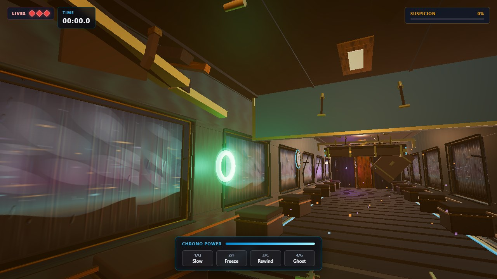
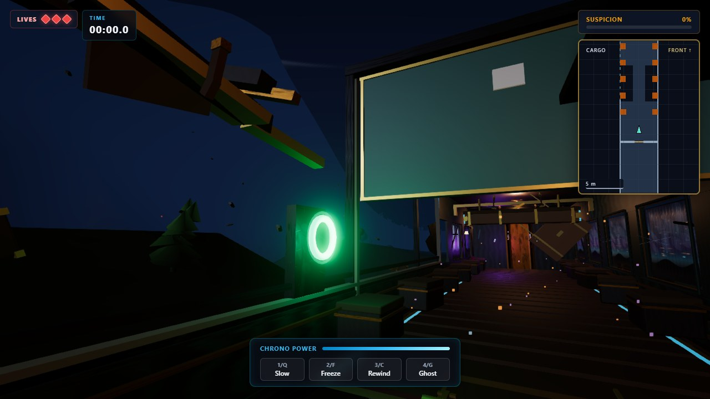
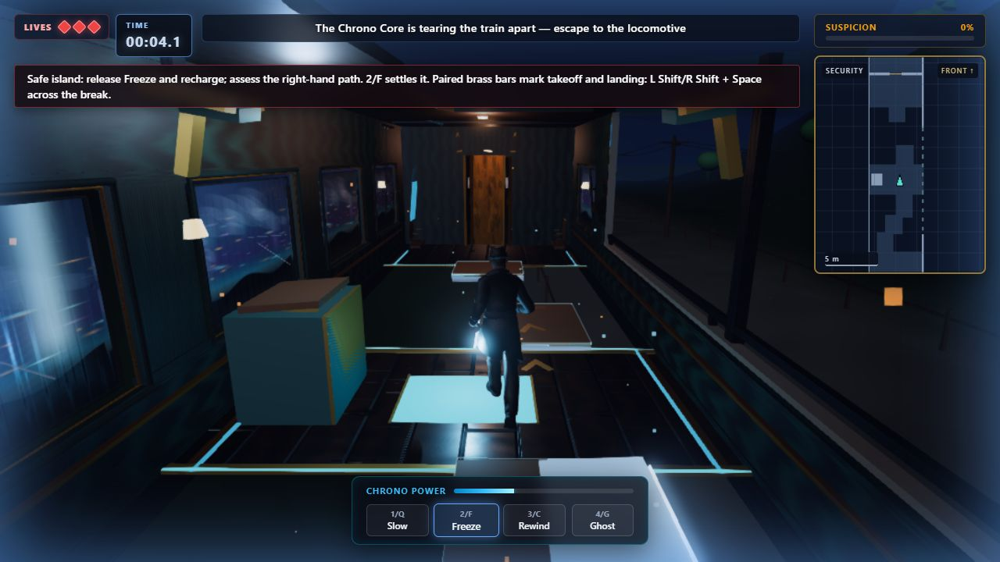

# Level 3 structural rebuild

28 October 2026 · `lvl3-visual-refresh` · implementation and validation record

Cargo and Security now have connected, geometric side/roof openings. The remaining cars alternate exposure and shelter. These are real missing surfaces, with retained floor/chassis, capped roof thickness, torn shoulders, attached folds and sparse structural roots. The game still uses its existing movement, collision, support and temporal systems.

## Source baseline and preservation

Discovery began with the dirty tree described in the implementation prompt, including `wreck-geometry.js`, the camera/AA fixes, atmosphere motion fixes and visual tests. During discovery, HEAD independently changed from `169f9df` to `bd92a56e2c85d5322f188fe96afa58eeefb8039b` (“Polish Timewreck visuals and motion”), incorporating that work. No Git write operation was run for this rebuild. The implementation builds on that preserved work. The full baseline suite passed **224 tests** before shell changes.

`lvl3-rebuild/before/` contains all eight start views in first and third person, plus Cargo/Security interior, exterior and overhead diagnostic captures. `baseline-profile/` adds the existing CPU/GPU instrumentation. Source replay for a controlled comparison uses `scripts/lvl3-baseline-server.mjs`: a read-only Vite loader serves the preserved commit without a checkout, reset or file swap.

## Protected spaces and ownership

Travel remains **Vault → Convergence → Mechanical → Cargo → Relay → Security → Passenger → cab**, towards decreasing Z. The shell half-width is 2.6 m, ceiling 3.5 m, player centre bounds approximately ±2.3 m and collision radius 0.18 m. Standing/crouch body checks remain 1.85/1.15 m. Existing jump constants imply a 1.138 m rise, approximately 2.988 m standing-head clearance. New structural geometry clears that envelope; supports and floor cuts retain their names, positions and heights.

| Car | Local tear Z / side | Side length affected | Protected geometry / approach |
| --- | --- | ---: | --- |
| Vault, 18 m | −0.8…3.0 / +X | 21% | Both laser racks, their moving emitters, pads, left containment bypass and spawn. The higher 1.35 m sill contains this rupture. |
| Convergence, 40 m | −5…10 / −X | 37.5% | Partition X=0.85; sheltered X=0.92…2.6 lane and 1.34 m underside; shutter, threshold, trolley weave, surge and connector. The direct lane loses adjacent roof; the low route remains visibly roofed. |
| Mechanical, 30 m | −6.2…3.4 / −X | 32% | Trunk sweeps to ±2.5 m, three original rails, shutter, steam attachments and right switching recess. A short retained root meets the exposed machine rail. |
| Cargo, 28 m | −4.5…8.4 / −X | 46% | Gangway void Z=+3.8…+8.6, exact hinges/stops and landing; loop door/load; freight at Z=−7 and its full sweep. The door keeps a tall hoist, the phase indicator a guarded mount, and the folded rack an end attachment. Floor trim and loose luggage no longer bridge/float above the gap. |
| Relay, 18 m | −4.8…−0.4 / +X | 24% | Ghost platform/occupancy, linkage, blast leaves, permanent catch, cabinet bypass and observation spaces. The operator side remains sheltered. |
| Security, 20 m | −4.9…5.2 / +X | 50.5% | Both original full-width holes, five exact decks, central recharge island, jump marks and local recovery. Sparse retained roots support the existing sheared ribs. |
| Passenger, 20 m | −5.6…2.4 / +X | 40% | Left falling rack/right avoidance lane, seat weave, collapse pads, depletion, chasing wave and cab sightline. The rack's roof stays intact. |
| Cab, 8 m | +0.1…+1.4 / −X | 16% | Original backhead, brake name/mesh, aim/range, lever, final Freeze and handoff. |

Percentages refer to one side's affected length. The roof bites are asymmetric, not mirrored. Low sills/guards remain at the movement boundary; no new side exits, rooftop routes, usable ledges or floor holes were introduced. New art batches belong to individual carriages. Camera and interaction rays see geometric openings, with retired fixtures explicitly unable to raycast.

Root-owned hazards retain their original coordinates and snapshot registrations. At Passenger's existing rear cutoff, their visual counterparts retire, their light sources stop supplying the pool, and the minimap drops inaccessible cars. Convergence and Relay retire at this existing cutoff rather than gaining invented detachment choreography. Vault, Mechanical, Cargo and Security retain their original detachment motions. Checkpoint restoration restores the original visual state and parent relationships. Retirement also stays applied during the brake handoff.

## Integration

- `wreck-damage.js` supplies the small authored profiles to shell, fixtures, roof straps and minimap. Retained bands/piers are segmented; panes and their complete surrounds are omitted when intersecting a tear. The roof is a closed extrusion with a jagged notch, a separate steel skin and metre-scaled textures.
- New structure is merged by material **within each carriage**. Repeated window members retain instancing. Removed fixture resources remain under an invisible, non-raycasting carriage-owned branch for deduplicated disposal. Zero-instance remnants retire too.
- The visible sky, one-time reflection capture, terrain direction and cool fog now share the L3 moon/storm treatment. The visible sky samples the existing capture after profiling showed that evaluating full scattering/cloud noise across every frame added GPU cost. It is an infinite direction-sampled sky, not a fixed-camera landscape plate; the captured clouds are static. Existing MEDIUM scenery remains; its underfloor cues are named separately from exterior scraps. Scraps now clear the complete ±2.6 m hull. There are no new shadowed lights or reflection captures per frame.
- The **12-point light pool** remains. Unsupported ceiling fills move towards retained shelter; hazard, stasis and brake sources keep their existing roles. A scoped use of the existing post grade removes the orange shadow lift from L3, while practical lamps supply warmth. Exposure, AA and quality controls remain unchanged.
- Exposure wind uses one quiet, filtered looping voice through the existing master/mute/pause graph. Freeze hushes it; reset/disposal release the complete graph. Warning voices remain separate.
- Retained storm panes now use the scaled carriage clock, including zero-delta hold and reversal. New permanent damage is static.
- Minimap solid walls terminate at the authored cut. Dashed, subdued guards show the remaining movement boundary. Real voids are subtracted and only registered supports are restored; decoration cannot become map floor. L2 retains its previous path.

Energy, costs, recharge/recovery, Ghost rules, disabled L3 strain, movement speeds, wave speed/lead, checkpoints, encounter windows and brake timing were not retuned. Ending source, train assets, plates, shot choreography and alignment were not edited.

## Rendered evidence

[Open the complete before/after gallery](lvl3-rebuild/index.html).

The review harness uses the actual L3 level, collision/supports, player-camera modules, postprocessing and minimap, with seeded debris. It uses the procedural fallback player rather than the loaded detective; it is labelled diagnostic. Main-game captures below use the loaded character and actual keyboard controls.

| Coverage | Evidence |
| --- | --- |
| All eight starts, both player views | `before/` and `verified/` beneath `lvl3-rebuild/` |
| Cargo pilot: inside, outside, above | `cargo-pilot/` |
| Final Cargo/Security geometry and sky | `verified/cargo-{inside,outside,above}.jpg`, `verified/security-{inside,outside,above}.jpg` |
| Sheltered low-route first/third cameras | `states/convergence-low-{first,third}.jpg` |
| Failed/repaired-held gangway, held decks/island | `states/cargo-{failed,restored-held}.jpg`, `states/security-{held-decks,island}.jpg` |
| Rearward breakup | `states/rearward-breakup.jpg` |
| Real keyboard Cargo crossing and loop | `play/cargo-real-{gangway,loop}-crossed.jpg` |
| Real keyboard Security island and jump exit | `play/security-real-{island,jump-exit}.jpg` |
| Pause, Ghost/cancellation, restart | `play/`, with position/event results in `play/results.json` |
| High / Balanced / Performance / Auto, 4:3 / portrait | `play/quality-*.jpg`, `play/aspect-*.jpg` |
| Real keyboard Passenger crossing, sprint, brake into Ending | `finale/`, with event positions in `finale/results.json` |
| L2 and repeated L3 → Ending resource checks | `parity-final/` |

The first Security automation attempt overshot its lateral target and fell. After input releases were synchronized to rendered frames, the island and final jumping leg were crossed successfully without a pose change. The successful main-game Cargo, Security and Passenger runs have no captured page errors. They are checkpoint-start playthroughs, not one uninterrupted whole-train browser run. The continuous Vault-to-brake route is additionally covered by the existing deterministic integration test in both fork variants and at multiple simulation rates. Expanded new-art clearance probes include the player's full ±2.48 m body envelope across ten height slices; they caught an inward sheet fold, which was bent outward.

### Before / after

Cargo before:

Cargo rebuilt:

Security rebuilt, main-game island:

## Checks

- Baseline: **224 tests passed**.
- `npm.cmd test`: **233 passed, 0 failed**. The focused structural suite includes cut-through rays, full body/jump clearance, no Cargo furniture above the void, map void/support agreement, unsafe-occluder rejection, retirement/reset, resource disposal, exterior scrap clearance, window-clock reversal and captured-sky ownership.
- `npm.cmd run build`: passed. The existing >500 kB JavaScript chunk warning remains.
- `node scripts/check-production.mjs`: passed; **57 files, 71.02 MiB, 56 asset references**, including case-sensitive subdirectory HTTP checks.
- `git diff --check`: passed.
- The regression suite includes connector, Cargo, Relay, Security, expansion/spatial, debris/flying panels, feedback, continuous escape, visibility, cameras, minimap, Ending and lifecycle tests. It exercises checkpoint retries, energy/power transitions and expiry, Ghost occupancy/cancellation, pause, restart/quit, rebinding and repeated transitions.
- Final real-renderer lifecycle check: three L3 → Ending cycles each returned Ending to **174 geometries / 57 textures**, with **zero L3 sky domes**. L3 retained exactly one dome per entry; the second/third warmed L3 entries each used 1,003 geometries / 126 textures. These are renderer allocations after the sampled views, not total scene-object counts or a complete memory-leak proof.
- L2 first/third views were also rendered from the preserved source in `parity-before/`. The layout and the broad yellow region visible ahead are present in both versions; that pre-existing region was not investigated as part of this L3 rebuild.

Raw test/build logs live in `reports/lvl3-rebuild-*.log` (ignored by Git); raw frame/query samples remain alongside the screenshot sets.

## Performance: mixed result, no smooth-FPS claim

Hardware: **12th Gen Intel Core i7-1255U / Intel Iris Xe**, ANGLE Direct3D 11, isolated headless **Chrome 156.0.8078.48**, Windows. Vite development renderer, 1280×720, device/render ratio 1, High, exposure 1.15, bloom and L3 FXAA enabled, existing MEDIUM scenery and 12-point pool. Both versions use the same real level/camera/post/minimap modules and procedural fallback player. The baseline is the preserved `bd92a56` source, served read-only on a separate port.

The final paired captures pin debris to 12345 and the legacy outdoor scatter to 7143. The latter is a **diagnostic browser response transform**, applied identically to both runs, with no game-source change. This avoids confounding the comparison with the legacy scenery's `Math.random()` placements. Runs were sequential, with no second task browser or test suite active. Other system activity, thermals and driver scheduling were not controlled.

Paused overhead samples last about 4 s after the inside/outside/above captures. Active first-person samples use 3 s warmup and 6 s measurement while standing at the checkpoint, including real level, player and hazard updates. Loading/initial shader compilation are excluded. Samples retain uncapped rAF intervals and slow tails. Fresh GPU queries are matched to measured frame IDs; pending tails are not estimated. There were no disjoint events or captured page errors. Short captures are diagnostics, not a full hardware benchmark.

Values are **baseline → final** in milliseconds:

| View | Mean frame / P95 / P99 | CPU update | CPU scene | GPU scene |
| --- | --- | --- | --- | --- |
| Cargo, paused overhead | 29.95 → 30.36 / 49.7 → 50.1 / 50.1 → 50.2 | ~0 | 18.88 → 17.36 | 6.09 → 7.19 |
| Security, paused overhead | 29.43 → 29.51 / 50.0 → 50.1 / 50.2 → 50.2 | ~0 | 19.03 → 17.54 | 5.93 → 6.89 |
| Cargo, active first person | 41.55 → 34.94 / 50.2 → 50.1 / 66.7 → 66.8 | 2.10 → 2.23 | 19.93 → 16.85 | 11.58 → 9.90 |
| Security, active first person | 31.24 → 41.22 / 50.0 → 66.8 / 50.3 → 100.1 | 1.87 → 2.40 | 17.66 → 23.35 | 7.85 → 8.80 |

CPU scene includes traversal, sorting, shadow preparation and submission. CPU draw includes scene/post/map and must not be added to those subsets. GPU shadow queries were effectively zero. Active GPU bloom was 1.51 → 0.65 ms in Cargo and 0.70 → 0.78 ms in Security; final output/AA was 1.78 → 1.65 and 1.76 → 1.81 ms respectively. Active minimap CPU was 0.26 → 0.19 and 0.24 → 0.44 ms. The complete draw/post/minimap timings and query counts are in the JSON summary.

| Paused view | Draw calls | Triangles submitted | GPU geometries | GPU textures | Programs |
| --- | --- | --- | --- | --- | --- |
| Cargo | 634 → 606 | 161,840 → 160,640 | 1,120 → 1,024 | 108 → 101 | 40 → 40 |
| Security | 587 → 521 | 144,046 → 145,080 | 706 → 640 | 86 → 79 | 37 → 37 |

**The no-regression/frame-pacing target is not established.** Cargo's active mean improves in this run; Security's active mean and tail regress. Paused GPU scene cost rises by roughly 1 ms as the openings reveal the world. Reduced submissions/resources do not prove an FPS improvement. The loaded main-game character is more expensive than this harness; an early concurrent main-entry capture showed about 8 FPS/125 ms and is retained only as an uncontrolled observation. Usable frame pacing remains unresolved.

Overdraw, independent shader-compilation time, power/thermal telemetry and per-material GPU attribution were not measured. No broad renderer, AA, resolution-policy or shadow changes were made to disguise that limit. Initial exploratory captures are retained separately and must not be substituted for the seeded paired comparison.

Reproduction: start the normal Vite server on port 5175 and `node scripts/lvl3-baseline-server.mjs` on 5176. Set `LVL3_ORIGIN=http://127.0.0.1:5176`, run `node scripts/lvl3-browser-check.mjs profile-seeded-before cargo,security`, then unset that variable and run `node scripts/lvl3-browser-check.mjs profile-seeded-after cargo,security`. Run `node scripts/lvl3-summarize.mjs`. The capture script supports `PLAYWRIGHT_PATH` for the local installed runtime. Source hashes, protocol and raw data are in [`performance-summary.json`](lvl3-rebuild/performance-summary.json).

## Limits and remaining risk

- The game still has poor frame pacing on this Iris Xe setup. Passing tests and fewer retained fixture meshes do not establish smooth gameplay or a performance improvement.
- This is a stylized structural rebuild, not photorealism. Retained windows still use the established opaque storm-window treatment; none of those panes crosses a major tear.
- Browser checks use isolated headless Chrome and several checkpoint starts. They do not cover every possible camera orbit, graphics driver, power expiry point or one uninterrupted human end-to-end route. Detailed ability expiry, collision, retry, restart/quit and repeated transitions also rely on the regression suite.
- No remote deployment, commit or push was performed.
