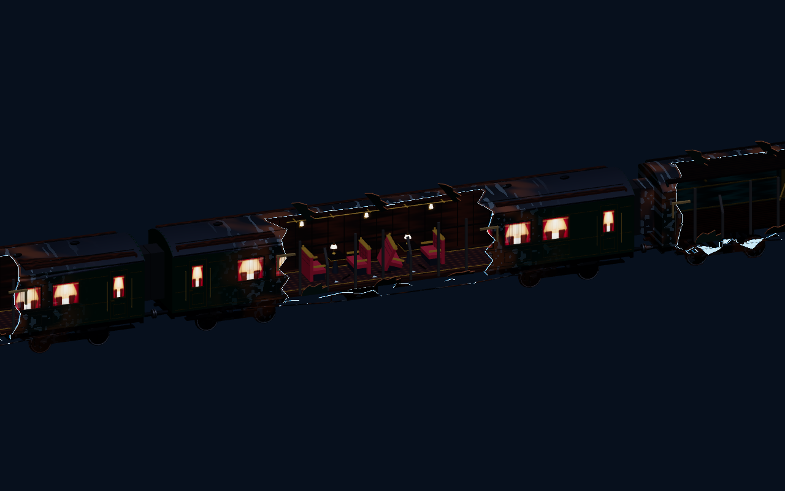

# Level 3 structural rebuild: analysis

28 October 2026 · Branch: `lvl3-visual-refresh`

## Finding and scope

Level 3 needs a structural art rebuild. Its present damage mostly decorates an intact corridor. Some carriages should instead lose a substantial continuous section of one side and the adjacent roof, as in the final cinematic. Preserve the floor, puzzle geometry and surviving structural skeleton so the level remains playable and recognisably the same train.

No game source was changed for this analysis. The previous visual/motion implementation is still uncommitted and must be preserved. HEAD is `169f9dfa67ef958989b365deb94740c7301876c0`; HEAD alone does not include that work.

## The actual reference

This is a fresh render of the existing ending train with simple diagnostic lighting and a plain background. It is not a capture of the complete cinematic. The raw `ending-plate*.jpg` images contain the landscape; the damaged train is separate 3D geometry.

Relevant source:

- `src/environment/ending-train.js`: four cinematic carriage pivots, roof subdivisions, material ownership and damage application.
- `src/shaders/ending-time-damage.js`: large continuous wall-to-roof tears, irregular teeth, sag, ageing and narrow blue rims.
- `src/environment/ending-debris.js`: exposed interior structure and debris.
- `src/environment/ending-gorge.js`: cool directional moonlight and hemisphere fill.

The long openings span approximately 8–8.8 m on 20 m cinematic carriages. Their silhouette matters more than copying an exact percentage: intact end sections, a missing central side/roof region, exposed floor and remaining ribs, attached torn edges and visible interior furniture. This is much stronger than cracked windows or scattered roof tiles.

Do not directly transplant the cinematic model. Its wall coordinates are around local X = ±1.45; playable L3 uses ±2.6, a 3.5 m ceiling and several much longer cars. The ending treats local +Z as forward before its parent transforms; L3 escape travel is world -Z. The ending has four cinematic carriages, whereas L3 has seven gameplay cars plus the cab. Match the design language, not those dimensions or a fictional one-to-one correspondence.

## Why L3 still looks enclosed

`src/environment/carriages.js` omits ordinary full side-wall boxes for damaged cars, but `addBlownViewports()` rebuilds both sides with continuous upper/lower bands and piers between regularly spaced window bays. Every bay still receives a full glass pane, including the more damaged variants. `stormWindowMaterial()` is an opaque painted/emissive storm-window material, not transparent glass revealing the actual exterior.

`buildShell()` also creates a full coffered ceiling. The damage pass adds attached fragments, exposed-looking ribs, pipes and cables, but does not remove a corresponding large region of that ceiling. Thus a damaged fragment can sit in front of intact lining. Repeated complete window frames and wall bands continue to dominate the silhouette.

The recent bevel, material, anti-aliasing and motion changes help surface quality. They cannot create missing volume. Adding more loose props would further crowd the existing corridor rather than solve this structural problem.

## Proposed carriage treatment

The following is a proposed art plan, not an instruction to change gameplay. Percentages are rough lengths of the selected side affected by a connected opening, not percentages of the entire vehicle or floor. Confirm the openings from actual first-/third-person approach views before fixing the final profile.

| Car, escape order | Structural direction | Gameplay that defines the protected space |
|---|---|---|
| Vault, 18 m | Mostly contained opening beat; one upper-side/roof rupture near the containment damage, roughly 15–25% of one side. Preserve recognisable enclosure around the lasers. | Two phased laser racks, observation pads, right-side containment obstruction/left route, oncoming debris and safe spawn. |
| Convergence, 40 m | A long roof/side peel over the exposed direct lane, roughly 30–40%; retain the sheltered maintenance side. Break the long visual repetition. | Partition near X=0.85; right low route at X≈0.92–2.6 with roof underside≈1.34 m; shutter, threshold, trolley weave, surges and the inter-car connector. |
| Mechanical, 30 m | One substantial side opening and intermittent missing upper lining, roughly 25–35%. Keep visible supports for machinery, steam pipes and moving trunk banks. | Full-width trunk sweeps, maintenance shutter, switching recess at X=1.75, steam, repair/hold sequence and checkpoint. |
| Cargo, 28 m | First strongly half-open hero car: approximately 40–50% of one side with a connected roof tear. Retain the opposing side, floor/chassis and structural supports. | Hinged gangway, its exact full-width floor cut, loop door/load, hinge stops, freight pendulum sweep/anchor, recovery floor and existing rupture dressing. |
| Relay, 18 m | A more sheltered recovery/readability beat; offset side/roof damage around 20–30%, away from the operator-station mechanism. | Ghost pad, linkage, blast door, far-side permanent catch, cabinet bypass, recharge/observation spaces and binding-aware guidance. |
| Security, 20 m | Most exposed hero car: roughly 45–55% of one side, roof partly peeled back. Frame the existing broken floor against a real exterior view. | Both floor openings, five moving decks, intact central recharge island, landing/jump marks, entry/exit supports and local retry checkpoint. |
| Passenger, 20 m | Broad asymmetric side/roof loss around 35–45%; surviving torn arches frame the forward sprint and visible breakup behind. | Left falling rack and right avoidance lane, seats/weave, collapse floor/supports, depletion trigger, pursuing wave and sprint sightline. |
| Cab, 8 m | Retain a legible locomotive enclosure; limited upper/side damage around 10–20%, giving a controlled brake reveal. | Brake mesh/interaction/range, safe arrival, final Freeze and existing cinematic handoff. |

Cargo and Security should establish the main half-open look. Other cars provide a rhythm of shelter and exposure. Avoid mirroring the same tear on both sides or removing half of every car indiscriminately.

## Geometry, structure and materials

Use an L3-only authored damage profile per carriage: connected side/roof opening regions, retained posts/arches, torn edge positions and fixtures to omit. A small shared description should drive the affected shell surfaces and fixtures; do not introduce a general runtime destruction engine.

Generate the missing surfaces as actual geometry. Segment/trim wall bands, roof panels, window batches, trim, rails and cables at the same boundary. A hole must pass through exterior skin, interior lining, glass and intervening framing. Remove orphan lamps, floating curtains, continuous rails and fully intact window surrounds inside the rupture. Keep selected surviving ribs rather than a dense cage filling the opening.

Show believable thickness and construction: painted exterior steel, subframe, broken interior wood, torn lining, a few cut cables and attachment brackets. Fold sheet metal with a clear hinge/root. Use broad bends and local irregular fracture teeth, not uniformly serrated silhouettes. Preserve a few large forms, medium structural members and sparse small fragments.

Retain green/teal paint, brass, timber and burgundy upholstery. Keep wear local to fractures, attachments and exposed metal; avoid uniform rust or soot on every surface. Existing normal/roughness maps already exist. Use sensible texture scale, visible end grain/cut faces and restrained edge highlights. Genuine wet surfaces should not turn all wood into mirror-like plastic.

The cinematic shader uses fragment discard and darkens back faces. It is useful reference code, but copying it wholesale would leave CPU raycasts/occlusion bounds solid and can make playable interior backs too dark. Prefer real open geometry; any decorative shader needs matching depth/shadow treatment and explicit raycast/culling review.

## Traversal and collision contract

L3 movement uses explicit world-space bounds, obstacles, supports and voids. Mesh deletion alone does not change them. The current continuous X bounds are approximately ±2.3; shell sides are at ±2.6. There are already genuine cut-floor puzzles in the connector, Cargo, Security and Passenger. Preserve their mesh names, top heights, holes, supports, timing, warning windows and checkpoints.

Do not create new side exits, usable roof routes, alternate ledges or extra floor holes as an incidental art change. Retain convincing chassis-edge structure/guarding where existing bounds stop the player. A visually unguarded new drop with an invisible movement clamp would be a new mismatch. Truly allowing new side falls requires a separately designed movement/void/failure change and is outside the default rebuild.

Reserve standing/crouching/jumping player envelopes, both camera volumes, interaction rays and the full swept volumes of moving hazards. Roof tears must not remove the special Convergence low ceiling or imply that its sheltered route is now exposed. New structure must not block lateral dodges around the recurring lethal panels. Keep decorative fragments outside traversable/swept space, or register deliberate solid obstacles with corresponding tests.

Do not change energy/costs, power behaviour, Ghost occupancy/lifetime, local retries or finale speed to compensate for confusing art. Current maximum energy is 100, recharge 15/s, Slow/Freeze/Rewind drain 18/28/32 per second; Ghost costs 35 plus 1.5/s. Recovery floor is 50. Actual sprint is 6.8 m/s; the final wave is 6.2 m/s with a 12 m lead. These are compatibility constraints, not tuning suggestions.

## Lighting and the newly visible exterior

An opening must reveal a coherent world, not black void, a painted window panel or terrain crossing the train. L3 currently uses the legacy moving outdoor environment at MEDIUM density. It does not opt into the existing `moonlit-valley` scenery option. It captures `createSkyDome('timewreck')` for reflections and then disposes that dome; that capture does not create a visible sky. A real sky/horizon treatment is therefore part of opening the roof, not optional background polish.

Choose one coherent moon/storm direction and matching sky, fog and reflection environment. Maintain distant mountain/forest depth and grounded undercarriage/track cues. Do not paste the ending's fixed-camera landscape plate into a freely moving gameplay view. Reuse existing scenery/sky capabilities where appropriate, but compare their actual appearance and cost before changing the L3 environment wholesale. Preserve the ending's own world alignment, cameras and plates.

Use cool exterior light to reveal torn edges, with warmer surviving practical lamps defining interior islands. Retained roofs should still feel sheltered. The current shadowless aisle key, ambient and hemisphere fill can illuminate intact and missing roofs similarly; tune this relationship instead of globally raising exposure. Use local material occlusion/contact shading and restrained fill first. Evaluate at most a tightly bounded shadow solution for a nearby hero region if profiling supports it; avoid whole-train high-resolution shadows or one real light per new fracture.

L3 currently pools 12 point lights. Reposition/remove sources only with their physical fixtures and build the pool after all sources exist. Keep refresh delta, hazard washes, Freeze/stasis cues and brake ownership intact. Narrow temporal edge emission can echo the ending, but must stay secondary to physical fracture geometry and distinct from usable cyan/violet puzzle surfaces. No every-frame environment capture, heavy refraction, volumetric fog or new default full-screen effects.

The exterior helper includes close flyers around X=2.22–2.57 and streaks around X=2.08–2.3, while L3's shell is ±2.6. Audit these legacy offsets when exposing the shell. Decide which effects are under-floor track cues and which must be outside the hull; do not blindly relocate intentional gameplay panels.

## Ownership, breakup, camera, minimap and audio

The carriage groups live under the train root, but many hazards, support visuals and spatial dressing are root-owned and positioned in world Z. During Passenger, only selected carriage groups are explicitly detached: Vault, Mechanical, Cargo and Security. Convergence and Relay are not in that list. Opening the train makes this existing ownership split much easier to see: root-owned machinery/lining can appear to float beside a departing car.

Create an ownership inventory before changing parents. Parent static new shell components to their carriage. Preserve world/local coordinates and time snapshots for active hazards. Safely hide or transfer visual counterparts only after their section becomes inaccessible, consistent with current bounds and retry state. Do not reparent registered gameplay groups without converting their update/snapshot/collision assumptions. Restore all visibility/transforms on checkpoints and restart.

`wreck-visibility.js` treats explicitly marked solid boxes as occluders and projects bounds geometrically. Never mark torn, shader-cut or open wall regions as complete solid occluders. Split retained occluding panels or leave them non-occluding. Confirm nothing outside disappears through an actual hole, and minimap rendering restores temporary visibility.

Third-person camera collision and interaction blockers use mesh raycasts. Actual holes must also be holes to those rays. Keep the recent L3 camera hysteresis and inherited decorative `noCameraCollision` handling. Physical pillars/roofs still block the camera; harmless hanging trim should not pull it in. Check first person, third person, both crouch modes, jumping, narrow routes, respawn and view switches. Avoid solving clipping by moving the camera outside the hull permanently.

The minimap derives side-wall strokes from `listCarriageWallBoxes()` and static interior footprints separately from the rendered shell. Update its representation where walls disappear. Distinguish the retained gameplay boundary from a surviving wall; preserve real floor cuts and moving supports. Do not turn the map into an expensive second detailed render.

Use existing wreck/hazard audio routing for subtle extra wind/exposure and loose-metal creak where useful. Preserve warning audibility, master/mute/pause behaviour and power transitions. Larger wind does not justify constant loud noise, new autoplay paths or unbounded audio voices.

## Performance and evidence

Earlier in this session, an isolated headless Chrome run on Iris Xe remained around 11 FPS. A paused 1280×720, fixed-100% comparison averaged about 91.4 ms without smoothing and 90.2 ms with it. This short noisy diagnostic does not identify the underlying CPU/GPU bottleneck or establish normal interactive FPS. It does show that simply removing the new smoothing pass is not a demonstrated solution.

Opening the shell removes geometry but exposes more scenery and more cars. Both draw cost and overdraw can increase. Start from repeatable per-carriage captures and frame-time distributions. Separate CPU update, traversal/submission, GPU scene/shadow/post and minimap costs. Measure shader compilation/startup separately from steady play. Include actual hardware/settings/source state and tool overhead in the report.

Batch static structure by material within each carriage, instance repeated ribs/fasteners, share textures/materials appropriately, bound texture sizes and use scenery LOD/culling. Do not merge the entire train into one mesh, use runtime CSG, add many transparent layers, make every surface double-sided or add physics to every fragment. Fog is a visual depth cue, not proof that hidden scenery is cheaper to draw.

## Implementation order and acceptance

1. Record the dirty-tree baseline, source contracts, screenshots and measured costs. Create per-carriage protected-volume/ownership maps.
2. Implement the L3 shell/profile mechanism and one Cargo hero section, including complete cut-through surfaces, structural thickness and fixture removal. Compare inside, outside and overhead views.
3. Apply the authored rhythm to the remaining cars; preserve all existing puzzle floors and hazard sweeps.
4. Integrate the visible exterior, restrained lighting/material response, sound, camera, minimap, occlusion and breakup ownership.
5. Complete route, time-control, restart/lifecycle and rendering/performance verification. Iterate on actual screenshots rather than declaring success from tests alone.

The pilot is a validation stage, not a request to stop after one car or introduce an extra approval gate. The implementation agent should carry the authorised rebuild through to completion.

Required evidence: each carriage's approach/hero view in both player views; clear side-to-roof openings in Cargo/Security; intact floor supports and low route; readable warning/Freeze/Ghost cues; exterior/rearward breakup views; brake-to-Ending transition; High/Balanced/Performance/Auto behaviour; unchanged L2 and ending reference captures. Run the existing escape, connector, Cargo, Relay, Security, spatial, expansion, debris, feedback, visibility, camera, minimap, ending and lifecycle regressions, plus focused new opening/ownership tests, build and production packaging.

The earlier visual pass passed 224 tests, then 48 targeted tests after final luggage edits, plus build/packaging. Those are historical baseline results, not fresh verification of a structural rebuild. No new route playthrough or performance benchmark was run for this analysis. A specific user-supplied final still was not attached; the existing ending model and its source are the reference inspected here.
